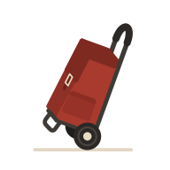

# Careto

  

  <strong>Your shopping list, filled in for you.</strong>

  

---

Careto (pronounced [kaˈre.to]) fills in the grocery list from what you cook and what you keep running
out of. Share a list with the people you shop with, plan the week's dishes,
and let Careto learn how often each product needs restocking.

## Features

- **Shared shopping lists**: invite people by email, even before they sign up.
- **Sign in your way**: email and password, or any OIDC provider.
- **Notifications**: OS-level push notifications on installed PWAs.
- **Multi-language**: English and Italian.
- **Installable**: a mobile-first PWA that also works on desktop.

See the [specification](docs/specifications.md) for the full feature set and
roadmap: items, dishes, week plan, and learning.

## Documentation

| Document | Description |
| --- | --- |
| [Development guide](docs/development.md) | How to run and work on the project |
| [Specification](docs/specifications.md) | The canonical product specification |
| [Architecture decision records](docs/adr/README.md) | Why things are the way they are |
| [Contribution methodology](AGENTS.md) | The process for making changes |

## License

Released under the [MIT License](LICENSE).
